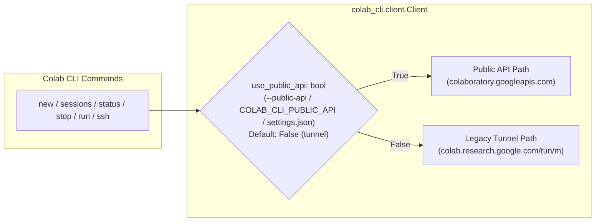

# Plan: Dual-Support Migration to the Colab Public API

## 1. Context from the Working Tree

1. **Why dual-API support is required**: The new Public API (`colaboratory.googleapis.com`) requires both the `colaboratory` OAuth scope and an OAuth client / ADC quota project allowlisted for `colaboratory.googleapis.com`. Credentials minted via `--auth=adc` under a user's default GCP project, custom `-c/--client-oauth-config` files, or older tokens without the `colaboratory` scope may be rejected by `colaboratory.googleapis.com` (HTTP 403), while still working against the legacy session tunnel (`colab.research.google.com/tun/m/...`, which only requires `userinfo.email`).

2. **[`2bdb30a6`](file:///usr/local/google/home/sethtroisi/Projects/colab-cli/src/colab_cli/client.py) (`moving to Colab Public API`) & Working Tree (`src/openapi/`)**:
   - Added `public_api: str = "https://colaboratory.googleapis.com"` to [`ColabEnvironment`](file:///usr/local/google/home/sethtroisi/Projects/colab-cli/src/colab_cli/client.py#L47-L50) and [`Prod`](file:///usr/local/google/home/sethtroisi/Projects/colab-cli/src/colab_cli/client.py#L54-L57).
   - Added Pydantic models in [client.py](file:///usr/local/google/home/sethtroisi/Projects/colab-cli/src/colab_cli/client.py#L150-L185) (`PublicVariant`, `PublicShape`, `ConnectionInfo`, `RuntimeSpecKey`, `Runtime`, `ListRuntimesResponse`) and replaced [`Client.list_assignments()`](file:///usr/local/google/home/sethtroisi/Projects/colab-cli/src/colab_cli/client.py#L301-L351) in-place to call `GET /v1beta/runtimes`.
   - Left [`assign()`](file:///usr/local/google/home/sethtroisi/Projects/colab-cli/src/colab_cli/client.py#L361-L403), [`unassign()`](file:///usr/local/google/home/sethtroisi/Projects/colab-cli/src/colab_cli/client.py#L353-L359), and [`get_consumption_user_info()`](file:///usr/local/google/home/sethtroisi/Projects/colab-cli/src/colab_cli/client.py#L295-L299) on `/tun/m/...`.
   - Uncommitted files in `src/openapi/` (extracted from `api.tar.gx`) contain generated OpenAPI models and `httpx` stubs for `GetRuntime`, `ListRuntimes`, `CreateRuntime`, `DeleteRuntime`, `ListRuntimeSpecs`, and `GetSubscription`.

---

## 2. Key Protocol & Data Model Differences

| Capability | Legacy Tunnel API (`/tun/m/...`) — **Default** | New Public API (`colaboratory.googleapis.com`) — `--public-api` | Key Adaptation Needed |
| :--- | :--- | :--- | :--- |
| **List Sessions** | `GET /tun/m/assignments` (XSSI-prefixed `ListedAssignments`) | `GET /v1beta/runtimes` (`ListRuntimesResponse`) | Map `Runtime` to `ListedAssignment`. Store `runtime.name` (`runtimes/{runtime_id}`) in addition to `endpoint`. |
| **Create Session (`assign`)** | 2-step XSRF (`GET /tun/m/assign?nbh=<b64>` + `POST /tun/m/assign` with `X-Goog-Colab-Token`) | LRO: `POST /v1beta/runtimes?runtimeId=<id>&requestId=<uuid>` -> returns `Operation` (`operations/<op_id>`), followed by polling `GET /v1/{op_name}:wait` (or `GET /v1/{op_name}`) until `done: true` | Generate RFC-1034 `runtimeId` (`r-<uuid4>`) instead of 44-char base64 `nbh`. Unpack `Runtime` from `operation.response` and map LRO `operation.error` codes to `TooManyAssignmentsError` / `ColabRequestError`. |
| **Delete Session (`unassign`)** | 2-step XSRF (`GET` + `POST /tun/m/unassign/{endpoint}`) | `DELETE /v1beta/{name=runtimes/*}?allowMissing=true` | **Critical**: `DeleteRuntime` takes `runtimes/{runtime_id}` (the `notebook_id_hash`), **not** `endpoint` (`m-s-...`). [`SessionState`](file:///usr/local/google/home/sethtroisi/Projects/colab-cli/src/colab_cli/state.py#L25-L38) must persist `runtime_name`. |
| **Token Refresh** | `GET /tun/m/assignments` matched by `endpoint` | `GET /v1beta/runtimes` (or `GET /v1beta/{name=runtimes/*}`) | Refresh via `list_assignments()` (matching `runtime_name` or `endpoint`). |
| **Usage Info (`colab usage`)** | `GET /tun/m/ccu-info` (CCU balance, burn rate, active count) | `GET /tun/m/ccu-info` | Calls `/tun/m/ccu-info` in both modes. |

> [!IMPORTANT]
> **`runtime_name` vs. `endpoint` Identity**:
> On `colaboratory.googleapis.com`, a runtime's resource name is `runtimes/{runtime_id}` (where `{runtime_id}` is stored internally as `notebook_id_hash`), while `connectionInfo.endpoint` is the internal VM identifier (`m-s-...`) marked with `COLAB_INTERNAL` visibility. `DeleteRuntime` and `GetRuntime` look up assignments by `{runtime_id}`, **not** `endpoint`. Persisting `runtime_name: Optional[str] = None` on [`SessionState`](file:///usr/local/google/home/sethtroisi/Projects/colab-cli/src/colab_cli/state.py#L25-L38) and [`ListedAssignment`](file:///usr/local/google/home/sethtroisi/Projects/colab-cli/src/colab_cli/client.py#L138-L144) allows both APIs to coexist seamlessly.

---

## 3. Step-by-Step Transition Plan

### Step 1: Clean Up Working Tree & Consolidate Models
1. Remove the untracked `api.tar.gx` archive and the generated `src/openapi/` directory (which introduces an external `httpx` dependency and non-package top-level module).
2. Keep all Public API Pydantic models in [`src/colab_cli/client.py`](file:///usr/local/google/home/sethtroisi/Projects/colab-cli/src/colab_cli/client.py) using the existing `requests` + `pydantic` stack:
   - `PublicVariant`, `PublicShape`, `ConnectionInfo`, `RuntimeSpecKey`, `Runtime`, `ListRuntimesResponse` (with `ConnectionInfo.endpoint: Optional[str] = None` in case a non-internal OAuth project strips `COLAB_INTERNAL` fields).
   - Add `Status` (`code`, `message`, `details`) and `Operation` (`name`, `done`, `metadata`, `error`, `response`) for `CreateRuntime` and `/v1/operations/...`.

### Step 2: Add `--public-api / --no-public-api` Flag, Env Var, and `Settings.use_public_api`
1. **Extend [`Settings`](file:///usr/local/google/home/sethtroisi/Projects/colab-cli/src/colab_cli/state.py#L40-L46) in [`src/colab_cli/state.py`](file:///usr/local/google/home/sethtroisi/Projects/colab-cli/state.py)**:
   - Add `use_public_api: bool = False` to `Settings` (persisted in `~/.config/colab-cli/settings.json`, defaulting to `False` so the tunnel API remains the default).
2. **Add global `--public-api / --no-public-api` option in [`src/colab_cli/cli.py`](file:///usr/local/google/home/sethtroisi/Projects/colab-cli/src/colab_cli/cli.py#L58-L96)**:
   - Add `public_api: Annotated[Optional[bool], typer.Option("--public-api/--no-public-api", envvar="COLAB_CLI_PUBLIC_API", help="Use the Colab Public API (colaboratory.googleapis.com) instead of the legacy tunnel API.")] = None`.
   - Store `state.use_public_api = public_api` (`Optional[bool]`, where `None` means "defer to `settings.json`").
3. **Resolve precedence in [`State.client`](file:///usr/local/google/home/sethtroisi/Projects/colab-cli/src/colab_cli/common.py#L70-L77) (`src/colab_cli/common.py`)**:
   - Resolution order:
     1. Explicit `--public-api` / `--no-public-api` CLI flag or `COLAB_CLI_PUBLIC_API` env var (`if self.use_public_api is not None`).
     2. Persistent `self.settings_store.load().use_public_api` (defaults to `False`).
   - Pass `use_public_api=resolved_bool` into `Client(Prod(), creds, use_public_api=resolved_bool)`.

### Step 3: Add Auth Capability Probe Utility, Caching, and Hidden `colab test-public-api` Command
1. **Extend [`Settings`](file:///usr/local/google/home/sethtroisi/Projects/colab-cli/src/colab_cli/state.py#L40-L46) in [`src/colab_cli/state.py`](file:///usr/local/google/home/sethtroisi/Projects/colab-cli/src/colab_cli/state.py) for Caching**:
   - Add cached probe fields to `Settings` in `~/.config/colab-cli/settings.json`:
     - `public_api_supported: Optional[bool] = None`
     - `tunnel_api_supported: Optional[bool] = None`
2. **Implement Probe Utility Function (`check_api_access`)**:
   - Add a utility function (e.g., in [`src/colab_cli/commands/utility.py`](file:///usr/local/google/home/sethtroisi/Projects/colab-cli/src/colab_cli/commands/utility.py) or [`src/colab_cli/client.py`](file:///usr/local/google/home/sethtroisi/Projects/colab-cli/src/colab_cli/client.py)) that makes lightweight, read-only GET probes (allocating no VM resources):
     - **Public API check**: `GET https://colaboratory.googleapis.com/v1beta/runtimes` (`_list_assignments_public()`).
     - **Tunnel API check**: `GET https://colab.research.google.com/tun/m/assignments` (`_list_assignments_tunnel()`).
   - Record whether each call succeeded (`True`) or failed with an auth/permission error (`False`, capturing HTTP status code and reason), persist `public_api_supported` and `tunnel_api_supported` to `state.settings_store`, and output the results for each backend.
3. **Register Hidden `colab test-public-api` Subcommand**:
   - In [`src/colab_cli/commands/utility.py`](file:///usr/local/google/home/sethtroisi/Projects/colab-cli/src/colab_cli/commands/utility.py#L390-L402), register `app.command(name="test-public-api", hidden=True)(test_public_api)` (alongside `whoami`).
   - Add `"test-public-api"` to `_AUTO_UPDATE_SUPPRESSED` in [`src/colab_cli/cli.py`](file:///usr/local/google/home/sethtroisi/Projects/colab-cli/src/colab_cli/cli.py#L109-L121) so the daily update check banner does not pollute the diagnostic output.
4. **Use Cached Probe Results in Auth Error Handling**:
   - When `Client._issue_request` (or command-level error handling) encounters HTTP 401/403 against either backend, update the cached flag for that backend (`False`) and consult the cached status of the other backend in `Settings`:
     - If a Public API request fails with 401/403 and `tunnel_api_supported` is `True`, surface a hint explaining that the current credentials cannot access `colaboratory.googleapis.com` and suggesting `--no-public-api` (or `colab test-public-api` to inspect).
     - If a Tunnel API request fails with 401/403 and `public_api_supported` is `True`, suggest `--public-api`.
     - If neither has been probed yet or both are `False`, suggest running `colab whoami` to diagnose scope and project access.

### Step 4: Update `SessionState` and `Client` Response Models for Cross-API Identity
1. **Update [`SessionState`](file:///usr/local/google/home/sethtroisi/Projects/colab-cli/src/colab_cli/state.py#L25-L38)**:
   - Add `runtime_name: Optional[str] = None` (e.g., `"runtimes/r-..."`). Existing `sessions.json` entries without `runtime_name` deserialize cleanly with `None`.
2. **Update [`ListedAssignment`](file:///usr/local/google/home/sethtroisi/Projects/colab-cli/src/colab_cli/client.py#L138-L144), [`PostAssignmentResponse`](file:///usr/local/google/home/sethtroisi/Projects/colab-cli/src/colab_cli/client.py#L187-L192), and [`Assignment`](file:///usr/local/google/home/sethtroisi/Projects/colab-cli/src/colab_cli/client.py#L205-L208)**:
   - Add `runtime_name: Optional[str] = None` to each model.
   - In Public API responses, populate `runtime_name = runtime.name` and `endpoint = runtime.connection_info.endpoint or runtime.name.removeprefix("runtimes/")`.
3. **Update [`common.py`](file:///usr/local/google/home/sethtroisi/Projects/colab-cli/src/colab_cli/common.py#L86-L148) (`get_session` & `sync_sessions`), [`commands/session.py`](file:///usr/local/google/home/sethtroisi/Projects/colab-cli/src/colab_cli/commands/session.py), and [`commands/run.py`](file:///usr/local/google/home/sethtroisi/Projects/colab-cli/src/colab_cli/commands/run.py)**:
   - Persist `runtime_name=getattr(res, "runtime_name", None)` when creating sessions in `new()` and `run_command()`.
   - In `get_session()` and `sync_sessions()`, match local sessions to server assignments by `endpoint` (or by `runtime_name` if `endpoint` doesn't match), and backfill `s.runtime_name = a.runtime_name` when present.
   - Pass `runtime_name=s.runtime_name` when calling `state.client.unassign(s.endpoint, runtime_name=s.runtime_name)` in `session.stop()` and `run.py`.

### Step 5: Implement Dual-Path Methods in `Client` (`src/colab_cli/client.py`)
1. **`list_assignments()`**:
   - Dispatch on `self.use_public_api` to `_list_assignments_public()` (`GET /v1beta/runtimes`) or `_list_assignments_tunnel()` (`GET /tun/m/assignments`).
2. **`assign(notebook_hash, variant, accelerator, shape)`**:
   - Dispatch on `self.use_public_api` to `_assign_public(...)` or `_assign_tunnel(...)`.
   - **`_assign_tunnel()`**: Existing 2-step `GET`/`POST /tun/m/assign` with XSRF token and retry/backoff recovery.
   - **`_assign_public()`**:
     - Format `runtime_id = f"r-{notebook_hash}"` (conforms to `^[a-z]([a-z0-9-]{0,61}[a-z0-9])?$`) and `request_id = str(uuid.uuid4())`.
     - Map `(variant, accelerator, shape)` to `RuntimeSpecKey` (`VARIANT_CPU`/`VARIANT_GPU`/`VARIANT_TPU`, accelerator string, `SHAPE_HIGHMEM` if `shape == Shape.HIGH_RAM` else `SHAPE_STANDARD`).
     - Issue `POST /v1beta/runtimes?runtimeId={runtime_id}&requestId={request_id}` with JSON body `{"runtimeSpec": ...}` and parse `Operation`.
     - Poll `GET /v1/{operation.name}:wait?timeout=30s` (or `GET /v1/{operation.name}`) until `operation.done` is `True`, honoring `COLAB_CLI_ASSIGN_RETRIES` and `COLAB_CLI_RETRY_BACKOFF` on transient HTTP/timeout errors.
     - Handle `operation.error`:
       - `code == 9` (`FAILED_PRECONDITION`) -> raise `TooManyAssignmentsError` (including `operation.error.message`).
       - `code == 6` (`ALREADY_EXISTS`) -> call `_get_runtime_public(f"runtimes/{runtime_id}")` (`GET /v1beta/runtimes/{runtime_id}`) and return `Assignment`.
       - `code in (3, 7)` (`INVALID_ARGUMENT`, `PERMISSION_DENIED`) -> raise `ColabRequestError` with mapped HTTP status (400 / 403) so caller entitlement handlers in `session.py` / `run.py` work unchanged.
     - Parse `Runtime` from `operation.response` and return `PostAssignmentResponse`.
3. **`unassign(endpoint, runtime_name=None)`**:
   - Dispatch on `self.use_public_api` to `_unassign_public(endpoint, runtime_name=runtime_name)` or `_unassign_tunnel(endpoint)`.
   - **`_unassign_tunnel(endpoint)`**: Existing `GET` + `POST /tun/m/unassign/{endpoint}` with `X-Goog-Colab-Token`.
   - **`_unassign_public(endpoint, runtime_name=None)`**:
     - Resolve `runtime_name`: if not provided, check if `endpoint` starts with `runtimes/` or `r-`; otherwise query `_list_assignments_public()` to find the runtime whose `endpoint` matches.
     - Issue `DELETE /v1beta/{runtime_name}?allowMissing=true` with `schema=None`.
4. **`get_consumption_user_info()`**:
   - Remains on `GET /tun/m/ccu-info` in both modes.

### Step 6: Testing Strategy for Dual-API Support
1. **Unit Tests in [`tests/test_client.py`](file:///usr/local/google/home/sethtroisi/Projects/colab-cli/tests/test_client.py)**:
   - **Default (`use_public_api=False`) Tunnel Suite**:
     - Restore `test_client_list_assignments` testing `GET /tun/m/assignments` with XSSI prefix.
     - Keep all existing `assign` (`_get_assignment` + `_post_assignment`, retries, 412, shape=hm) and `unassign` (`/tun/m/unassign/{endpoint}`) tests passing against default `Client(Prod(), mock_session)`.
   - **Public API (`use_public_api=True`) Suite**:
     - `test_public_client_list_assignments`: `GET /v1beta/runtimes` mapping variants, shapes, accelerators, `expireTime`, `runtime_name`, and empty response `{}`.
     - `test_public_client_assign_immediate` & `test_public_client_assign_polls_until_done`: `POST /v1beta/runtimes` returning `Operation(done=False)` followed by `GET /v1/operations/...:wait` returning `Operation(done=True, response=Runtime)`.
     - `test_public_client_assign_failed_precondition_raises_too_many_assignments`: `Operation(done=True, error={"code": 9, ...})` raises `TooManyAssignmentsError`.
     - `test_public_client_assign_invalid_argument_raises_400`: `Operation(done=True, error={"code": 3, ...})` raises `ColabRequestError` with status 400 (verifying `colab new --gpu A100` entitlement error handling).
     - `test_public_client_assign_already_exists_recovers`: `Operation(done=True, error={"code": 6})` recovers via `GET /v1beta/runtimes/{runtime_id}`.
     - `test_public_client_unassign_with_runtime_name` & `test_public_client_unassign_resolves_endpoint`: `DELETE /v1beta/runtimes/r-...` with `allowMissing=true`.
     - `test_auth_error_uses_cached_probe_for_remediation_hint`: Verify 401/403 on Public API checks cached `tunnel_api_supported` (and vice versa) to include actionable fallback advice.
2. **CLI, Probe Command, Common, and State Unit Tests ([`tests/test_cli.py`](file:///usr/local/google/home/sethtroisi/Projects/colab-cli/tests/test_cli.py), [`tests/test_common.py`](file:///usr/local/google/home/sethtroisi/Projects/colab-cli/tests/test_common.py), [`tests/test_state.py`](file:///usr/local/google/home/sethtroisi/Projects/colab-cli/tests/test_state.py))**:
   - Test `--public-api` / `--no-public-api` flag, `COLAB_CLI_PUBLIC_API` env var, `Settings.use_public_api`, and default (`False`) precedence.
   - Test `colab test-public-api`:
     - Hidden from `colab --help`, reachable via `colab test-public-api --help`.
     - Probes both `colaboratory.googleapis.com/v1beta/runtimes` and `colab.research.google.com/tun/m/assignments`, prints status for each, and persists `public_api_supported` and `tunnel_api_supported` in `SettingsStore`.
   - Verify `SessionState` round-trip persistence with `runtime_name` and backward-compatible loading when `runtime_name` is absent.
   - Verify `session.stop` and `run` forward `runtime_name` to `client.unassign`.
3. **Live End-to-End Integration Testing (`integration/`)**:
   - Add `integration/repro_public_api/test.sh` exercising `colab test-public-api`, `colab --public-api new`, `colab --public-api sessions`, `colab --public-api status`, `colab --public-api exec`, and `colab --public-api stop`, plus verifying no orphaned sessions remain via `colab sessions`.

### Step 7: Update Documentation
- Update [`AGENTS.md`](file:///usr/local/google/home/sethtroisi/Projects/colab-cli/AGENTS.md), [`docs/01_session_management.md`](file:///usr/local/google/home/sethtroisi/Projects/colab-cli/docs/01_session_management.md), and [`docs/04_automation_and_utility.md`](file:///usr/local/google/home/sethtroisi/Projects/colab-cli/docs/04_automation_and_utility.md) (with frontmatter log entries) to document `--public-api / --no-public-api`, `colab test-public-api`, `Settings.use_public_api`, and the dual-backend architecture.
